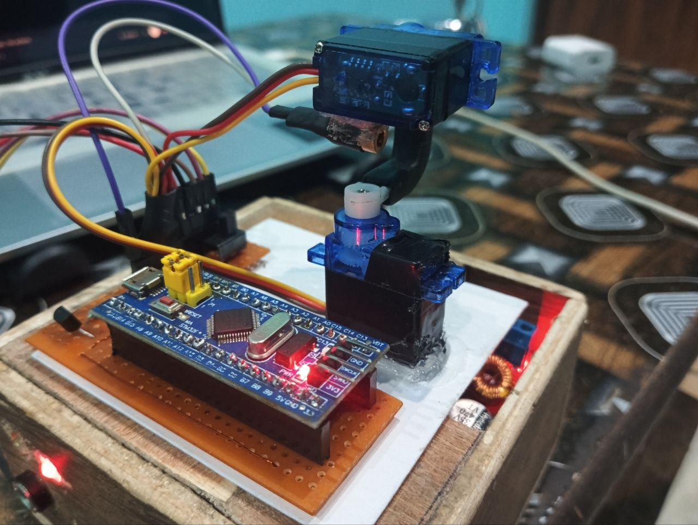

# Multi-Input Laser Turret


**Two servos, one laser, and a PC that sees. The aiming, the link and the safety watchdog are all built here — not bought as a kit.**

This is a PC-driven pan/tilt laser turret. The PC runs vision and aiming, an STM32 Blue Pill drives the two servos and the laser, and an ESP32 SoftAP carries commands over Wi-Fi so no USB cable ties the PC to the turret. Tracking runs on a hand, a head, or a target in a separate front camera.

The beam only stays on while a valid link is present. Lose the connection and the laser drops in 2 seconds while the gimbal holds its last position. No auto-park, no rest, no fold.

> **Safety:** keep the beam away from eyes. `Space` and `Esc` are the kill switches.

---

## Demo

[](https://youtube.com/shorts/UFWoeOp6Qgk)
Merged working + build short — tracking, wireless link and the custom PSU.

---

## Build Photos

| Photo | Description |
|---|---|
|  | Finished turret assembly |

The PSU is a shared dual-rail bench box, not turret-only. Its photo, rail map and
bring-up notes live in [forgeVII/Portable-Bench-PSU](https://github.com/forgeVII/Portable-Bench-PSU).

---

## Overview

| Property | Value |
|---|---|
| **MCU** | STM32F103C8T6 (Blue Pill) |
| **Motion** | 2× SG90 servo — pan / tilt |
| **Beam** | 5 V TTL laser module |
| **Link** | ESP32 SoftAP `TURRET_LINK` → TCP `192.168.4.1:8888` → UART0 |
| **Vision** | MediaPipe hand + face + pose on the PC |
| **Travel** | X `50..150`, Y `40..140`, centre `X100 Y80` |
| **Watchdog** | 2 s no-link → laser OFF, position held |
| **Power** | Dual 5 V rails, common ground — separate PSU repo |

---

## How It Works

```
PC (pygame + vision + aiming)
  -> ESP32 SoftAP "TURRET_LINK" (TCP 192.168.4.1:8888)
  -> UART0 -> STM32 Blue Pill
  -> PA1 / PA0 : X(pan) + Y(tilt) servos
  -> PA2       : laser ON/OFF
```

### Aim pipeline

1. The PC detects a hand, face or target in the camera frame.
2. Normalised camera point → wall point at the selected distance → inverse kinematics.
3. The result is sent as `S<pan>,<tilt>`: move and hold the laser ON. `F` turns the laser OFF and holds.
4. Losing a target holds the last aim — nothing snaps back to centre.

### GPIO map (locked — 5 GPIO used)

| Pin | Function | Type |
|---|---|---|
| PA1 | Servo X — pan | PWM out |
| PA0 | Servo Y — tilt | PWM out |
| PA2 | Laser ON/OFF | Digital out |
| PA9 | UART TX (from ESP32) | UART |
| PA10 | UART RX (to ESP32) | UART |

The HC-SR04 was tried and discarded; it is not part of the build.

---

## Modes and Controls

| Key | Action |
|---|---|
| `1` | MANUAL — gamepad sticks (`G` toggles STICK↔KEY) or arrow keys |
| `2` | HAND / FACE tracking on the user camera |
| `3` | ENEMY TRACK on the front/target camera |
| `Space` | MANUAL arm toggle — real laser + motion |
| `F` | Laser OFF, hold position |
| `R` | Frame-centre hold + calibration — laser ON, cyan crosshair |
| `C` | Recentre head + aim |
| `Tab` | Camera setup |
| `Esc` | Quit |

Full key map, calibration values and gotchas are in `CONTEXT.md`.

---

## Firmware and Software

| Folder | Target |
|---|---|
| `firmware/turret_main/` | STM32 servo + laser + link watchdog |
| `firmware/esp32_bridge/` | ESP32 SoftAP TCP-to-UART bridge + OTA |
| `firmware/esp32_bridge_archive/` | Old sketches — reference only |
| `simulation/` | PC simulator, vision and aiming |

---

## Quick Start

1. Power the PSU, join PC Wi-Fi to the open `TURRET_LINK` network.
2. Run `python main.py` from `simulation/`.
3. The simulator connects to `192.168.4.1:8888` automatically; `L` forces a reconnect.
4. `Tab` opens camera setup. `F9` windowed, `F10` fullscreen, `F11` toggle.

---

## Project Structure

```
laser_turret/
├── firmware/
│   ├── turret_main/            # STM32 firmware
│   ├── esp32_bridge/           # Wi-Fi bridge + OTA
│   └── esp32_bridge_archive/   # reference only
├── simulation/                 # PC sim, vision, HUD
├── media/photos/               # build photos
├── CONTEXT.md                  # full technical source of truth
├── TRACKER.md                  # build tracker and parts
├── UI_HANDOVER.md              # HUD constraints and display architecture
├── MEDIA.md                    # media slots and video links
├── LICENSE
└── README.md
```

---

## What's Next

- Live re-test of `R` fine trim (8°/s, ±10° clamp) and mode-3 target lock after the direction fixes.
- Better enclosure and cable management.
- Face-ID mode parked pending landmark alignment.

---

## Built By

Harish Chand — `forgeVII`. Personal build: learning, experimenting, shipping.

---

## License

MIT License — use freely, build your own, share what you make.
